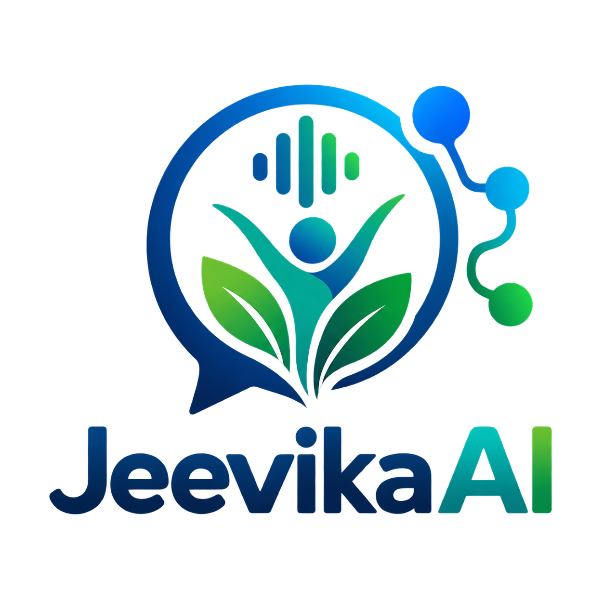
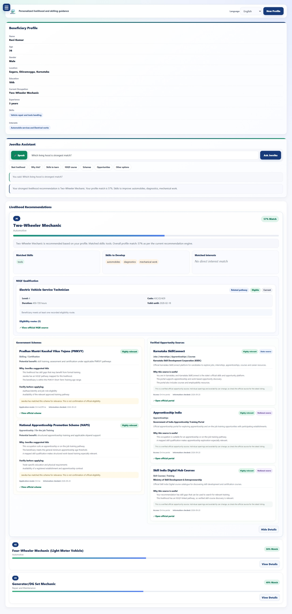
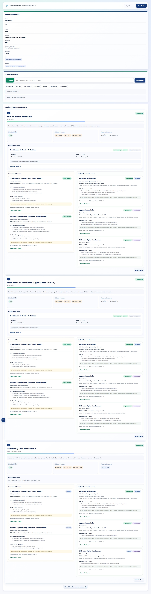
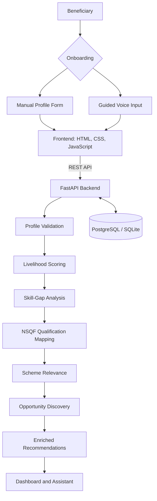

 
<p align="center">
  
</p>

<h1 align="center">Jeevika AI</h1>

<p align="center">
  <strong>Explainable Multilingual Livelihood Intelligence for Beneficiary-to-Action Pathway Discovery</strong>
</p>

<p align="center">
  
  
  
  
  
  
  
  
</p>

<p align="center">
  <a href="https://jeevika-ai-sooty.vercel.app/">Live Demo</a> ·
  <a href="https://jeevika-ai-api.onrender.com/docs">API Documentation</a> ·
  <a href="#local-setup">Run Locally</a>
</p>

---

## Table of Contents

- [Overview](#overview)
- [Problem Statement](#problem-statement)
- [Smart India Hackathon 2026](#smart-india-hackathon-2026)
- [Screenshots](#screenshots)
- [Key Features](#key-features)
- [How It Works](#how-it-works)
- [Recommendation Engine](#recommendation-engine)
- [Skill-Gap Analysis](#skill-gap-analysis)
- [NSQF Qualification Mapping](#nsqf-qualification-mapping)
- [Government Scheme Intelligence](#government-scheme-intelligence)
- [Opportunity Discovery](#opportunity-discovery)
- [Jeevika Assistant and Voice Support](#jeevika-assistant-and-voice-support)
- [Technology Stack](#technology-stack)
- [Architecture](#architecture)
- [API Reference](#api-reference)
- [Example Beneficiary Profile](#example-beneficiary-profile)
- [Project Structure](#project-structure)
- [Local Setup](#local-setup)
- [Testing](#testing)
- [Security and Privacy](#security-and-privacy)
- [Current Limitations](#current-limitations)
- [Roadmap](#roadmap)
- [Official Resources](#official-resources)
- [Team](#team)
- [Project Links](#project-links)

---

## Overview

**Jeevika AI** is a multilingual, explainable livelihood decision-support platform developed for Smart India Hackathon 2026, problem statement SIH26097.

The platform uses a beneficiary's education, existing skills, interests, work experience, and current occupation to identify potentially suitable livelihoods. It then connects those recommendations to skill-gap analysis, National Skills Qualifications Framework (NSQF) qualification information, government scheme relevance, and official opportunity-discovery platforms.

Rather than simply presenting a list of occupations, Jeevika AI aims to help beneficiaries understand:

- Which livelihood options may fit their profiles.
- Which skills they already possess and which they could develop.
- Which qualification pathways may be relevant.
- Which government schemes may be worth exploring.
- Where to find official training, apprenticeship, employment, and support resources.

The application combines a web-based beneficiary interface, a Python FastAPI backend, structured reference datasets, and a rules-based recommendation engine.

> **Project status:** Functional cloud-deployed MVP. The system is a decision-support prototype, not a production-hardened government service. Its recommendations and eligibility guidance require appropriate verification.

## Problem Statement

People seeking livelihood opportunities may have practical skills, informal work experience, and specific career interests without knowing how to translate them into suitable training or employment pathways.

Relevant information is distributed across qualification databases, government schemes, training programmes, apprenticeship portals, and employment platforms.

Beneficiaries may need to answer several connected questions:

- Which livelihood options match my background?
- What skills should I improve?
- Which NSQF qualification could support my next step?
- Which schemes might be relevant to my circumstances?
- Which official platform should I visit next?

Jeevika AI brings these questions into a single guided experience, connecting a beneficiary profile to explainable recommendations and relevant external resources.

## Smart India Hackathon 2026

| Field | Details |
|---|---|
| Problem statement ID | SIH26097 |
| Problem statement | AI-Driven Voice Assistant for Livelihood Mapping and NSQF-Aligned Skilling Recommendations for SC Communities under the GIA component of PM-AJAY |
| Ministry | Ministry of Social Justice and Empowerment (MoSJE) |
| Theme | Agriculture, FoodTech & Rural Development |
| Category | Software |
| Team | Innovatrix |
| Project status | Functional cloud-deployed MVP |

## Screenshots

### 1. Jeevika AI Dashboard

The dashboard brings together the beneficiary profile, Jeevika Assistant, ranked livelihood recommendations, matched skills, skill gaps, NSQF qualification details, government schemes, and official opportunity sources.



### 2. Livelihood Recommendation Details

The detailed view highlights the information provided for a recommendation, including the profile-fit score, existing skills, skills to develop, qualification mapping, scheme relevance, and opportunity-discovery links.



## Key Features

| Feature | Description |
|---|---|
| Beneficiary profile | Collects personal profile fields relevant to livelihood matching, including education, occupation, skills, experience, and interests. |
| Guided voice onboarding | Supports a voice-guided question flow using the browser's Web Speech API. |
| Multilingual interface | Supports English, Kannada, and Hindi. |
| Livelihood recommendations | Ranks potential livelihoods using a transparent, weighted profile-fit score. |
| Explainable matching | Presents the score, matched skills, skills to develop, and other recommendation details. |
| Skill-gap analysis | Compares existing beneficiary skills with the skills associated with a recommended livelihood. |
| NSQF qualification mapping | Provides related qualification details, levels, codes, duration, eligibility routes, and validity information where available. |
| Government scheme intelligence | Identifies potentially relevant schemes and explains why they may be worth exploring. |
| Opportunity discovery | Connects users with official state and national skill, training, and apprenticeship platforms. |
| Jeevika Assistant | Provides text-based and voice-assisted guidance in the context of a beneficiary's recommendations. |
| Persistent records | Supports beneficiary and recommendation persistence through the backend database. |

## How It Works

The application connects a beneficiary's profile to a series of related livelihood and skilling resources.

```text
Beneficiary Profile
        |
        v
Livelihood Recommendation
        |
        v
Matched Skills and Skill Gaps
        |
        v
NSQF Qualification Mapping
        |
        v
Eligibility and Validity Guidance
        |
        v
Government Scheme Relevance
        |
        v
Official Opportunity Discovery
        |
        v
Dashboard and Jeevika Assistant
```

The intended outcome is an understandable pathway from a beneficiary's current situation towards possible training, qualification, livelihood, and support options.

## Current MVP Data

The current curated datasets contain the following records:

| Dataset | Records |
|---|---:|
| Occupation catalogue | 124 |
| NSQF qualification records | 47 |
| Government scheme records | 6 |
| Opportunity-source records | 4 |
| Supported languages | 3 |

These figures describe the datasets included in the current project. They do not represent exhaustive national coverage.

## Recommendation Engine

Jeevika AI currently uses a **rules-based, data-driven recommendation engine**, rather than a trained machine-learning model.

The engine assigns weighted points to profile characteristics to estimate how well a livelihood matches the beneficiary's current profile.

| Scoring component | Weight |
|---|---:|
| Education compatibility | 15 |
| Required skill coverage | 35 |
| Interest alignment | 15 |
| Current occupation relevance | 25 |
| Related experience | 10 |
| **Total** | **100** |

Recommendations are ranked by their calculated profile-fit scores. The current implementation can return up to five recommendations that meet its configured score threshold.

**Important interpretation:** The match score represents profile fit under the current scoring rules. It is not a probability of employment, income growth, training completion, or livelihood success.

The scoring approach is designed to make recommendations more interpretable and easier to inspect than an unexplained prediction.

## Skill-Gap Analysis

For each recommended livelihood, the system compares the skills associated with that occupation against the beneficiary's recorded skills.

It presents two main categories:

- **Matched skills:** Skills the beneficiary already reports.
- **Skills to develop:** Skills identified as potential areas for improvement.

This information helps connect a livelihood recommendation to possible training or qualification pathways.

The identified gaps depend on the occupation catalogue and the profile information supplied. They should be treated as guidance rather than a formal skills assessment.

## NSQF Qualification Mapping

Jeevika AI connects relevant livelihood recommendations to available NSQF qualification records.

Where information is available, the interface can display:

- Qualification title and level.
- Qualification code.
- Training duration.
- Exact or related pathway classification.
- Recorded eligibility routes.
- Qualification validity information.
- Links to the relevant official source.

The system distinguishes between qualification mapping and beneficiary eligibility.

**Eligibility states**

- `Eligible`
- `Not Currently Eligible`
- `Needs Verification`

**Validity states**

- `Current`
- `Expired`
- `Not Active Yet`
- `Validity Unconfirmed`

A related qualification is not necessarily a direct match for every livelihood. Eligibility and validity must be confirmed against authoritative, up-to-date information before making training or enrolment decisions.

## Government Scheme Intelligence

The curated scheme dataset currently includes:

- Pradhan Mantri Kaushal Vikas Yojana (PMKVY)
- National Apprenticeship Promotion Scheme (NAPS)
- Prime Minister's Employment Generation Programme (PMEGP)
- Deen Dayal Upadhyaya Grameen Kaushalya Yojana (DDU-GKY)
- PM Street Vendor's AtmaNirbhar Nidhi (PM SVANidhi)
- Pradhan Mantri Mudra Yojana (PMMY / MUDRA)

The system provides relevance labels and profile-specific explanations intended to help beneficiaries identify schemes worth investigating.

Depending on the available record, scheme information can include potential benefits, verification requirements, application mode, and official links.

> **Scheme relevance does not establish eligibility or approval.** Eligibility depends on the official programme rules and the beneficiary's circumstances. Users must verify the current requirements with the administering authority.

## Opportunity Discovery

Jeevika AI currently includes four curated opportunity-source records:

| Source | Purpose |
|---|---|
| Karnataka SkillConnect | State-level skill and opportunity discovery |
| National Career Service (NCS) | National career and employment resources |
| Apprenticeship India | Apprenticeship discovery |
| Skill India Digital Hub | Skill-development and training-course discovery |

The system connects recommended pathways to these official discovery channels and explains why a source may be useful.

These records are links to opportunity-discovery platforms, not a live vacancy feed. Their inclusion does not guarantee that a particular job, course, apprenticeship, or placement is currently available.

## Jeevika Assistant and Voice Support

The Jeevika Assistant provides a text-and-voice interaction interface for asking questions related to a beneficiary's livelihood recommendations.

Example questions include:

```text
Why is this livelihood suitable for me?
What skills should I learn?
Which NSQF course may be suitable?
Which government schemes are relevant?
Where can I explore opportunities?
```

The assistant is intended to provide contextual guidance around the beneficiary's profile and available recommendations.

The current implementation should not be treated as a general-purpose conversational AI system or as an authoritative source of government eligibility decisions.

### Multilingual Support

The interface supports:

- English
- Kannada
- Hindi

Language selection is used across supported interface strings and voice-related features.

### Voice Onboarding

The guided voice onboarding flow uses the browser's Web Speech API to recognise spoken answers and support a step-by-step profile-entry experience.

Browser support and speech-recognition quality can vary by device, browser, microphone, language, and network conditions. Manual profile entry remains an alternative.

## Technology Stack

| Layer | Technology | Purpose |
|---|---|---|
| Frontend | HTML, CSS, JavaScript | Profile entry, dashboard, recommendations, and assistant interface |
| Voice | Browser Web Speech API | Speech recognition and speech synthesis |
| Localisation | JavaScript, `frontend/i18n.js` | Multilingual interface strings and speech locales |
| Backend | Python, FastAPI | REST API and application logic |
| Recommendation logic | Python modules | Scoring, livelihood mapping, and skill-gap analysis |
| Qualification and scheme logic | Python modules | NSQF, eligibility, scheme, and opportunity mapping |
| Validation | Pydantic | Request and beneficiary-profile validation |
| ORM | SQLAlchemy | Database models and persistence |
| Database | Neon PostgreSQL; SQLite fallback | Beneficiary and recommendation records |
| Frontend hosting | Vercel | Frontend deployment |
| Backend hosting | Render | API deployment |
| Knowledge base | CSV files | Occupations, qualifications, schemes, and opportunity sources |
| Version control | Git and GitHub | Source control and collaboration |

## Architecture



The frontend communicates with the FastAPI backend through HTTP endpoints. The backend validates profile data, calculates recommendations, enriches them with available reference information, and persists beneficiary and recommendation records.

## API Reference

**Base URL:** `https://jeevika-ai-api.onrender.com`

| Method | Endpoint | Purpose |
|---|---|---|
| `GET` | `/` | Service information |
| `GET` | `/health` | Health check |
| `POST` | `/beneficiaries/` | Create a beneficiary profile |
| `GET` | `/beneficiaries/{beneficiary_id}` | Retrieve a beneficiary profile |
| `POST` | `/recommendations/{beneficiary_id}` | Generate and save recommendations |
| `GET` | `/recommendations/saved/{beneficiary_id}` | Retrieve saved recommendations |
| `POST` | `/assistant/query/{beneficiary_id}` | Submit a question to the Jeevika Assistant |

Interactive endpoint documentation is available through [Swagger UI](https://jeevika-ai-api.onrender.com/docs).

### Example Assistant Request

```http
POST /assistant/query/1
Content-Type: application/json
```

```json
{
  "query": "Why is this livelihood suitable for me?",
  "language": "Kannada"
}
```

This example illustrates the request structure. The beneficiary ID must correspond to an appropriate record in the running application.

## Example Beneficiary Profile

The following example illustrates the kinds of information used for profile-based recommendations. It is sample data, not a real beneficiary record.

```json
{
  "name": "Ravi Kumar",
  "age": 36,
  "gender": "Male",
  "state": "Karnataka",
  "district": "Shivamogga",
  "village": "Sagara",
  "education_level": "10th",
  "current_occupation": "Two Wheeler Mechanic",
  "existing_skills": [
    "Vehicle repair",
    "Electrical works"
  ],
  "interests": [
    "Automobile services",
    "Electronic instruments"
  ],
  "preferred_language": "English",
  "experience_years": 6,
  "income_target": 20000,
  "willing_to_relocate": false
}
```

The backend applies profile validation rules to submitted data. The accepted fields and validation constraints are defined by the current implementation.

## Project Structure

```text
jeevika-ai/
├── backend/
│   ├── app/
│   │   ├── api/
│   │   │   ├── assistant.py
│   │   │   ├── beneficiaries.py
│   │   │   └── recommendations.py
│   │   ├── database/
│   │   │   └── database.py
│   │   ├── ml/
│   │   │   ├── eligibility_engine.py
│   │   │   ├── livelihood_mapper.py
│   │   │   ├── nsqf_mapper.py
│   │   │   ├── opportunity_mapper.py
│   │   │   ├── scheme_mapper.py
│   │   │   ├── scoring_engine.py
│   │   │   ├── skill_recommender.py
│   │   │   └── text_matcher.py
│   │   ├── models/
│   │   │   ├── beneficiary.py
│   │   │   └── recommendation.py
│   │   ├── schemas/
│   │   │   ├── beneficiary.py
│   │   │   └── recommendation.py
│   │   └── main.py
│   └── requirements.txt
├── data/
│   ├── nsqf/
│   │   └── nsqf_qualifications.csv
│   ├── occupations/
│   │   └── occupations.csv
│   ├── opportunities/
│   │   └── local_opportunities.csv
│   ├── schemes/
│   │   └── government_schemes.csv
│   └── test/
│       ├── validate_recommendations.py
│       ├── test_scoring_v2.py
│       ├── test_livelihood_mapper.py
│       ├── test_nsqf_mapping_v2.py
│       ├── test_scheme_mapper_v2.py
│       └── test_opportunity_mapper_v2.py
├── docs/
│   ├── jeevika-dashboard.jpeg
│   └── jeevika-dashboard-details.jpeg
├── frontend/
│   ├── assets/
│   │   └── jeevika-logo.png
│   ├── i18n.js
│   ├── index.html
│   └── voice.html
├── .gitignore
└── README.md
```

## Local Setup

### Prerequisites

- Git
- Python 3.10 or a compatible version supported by the project's dependencies
- A modern browser
- Optional: a PostgreSQL database for local PostgreSQL testing

### 1. Clone the Repository

```bash
git clone https://github.com/Adarsha-o-O/jeevika-ai.git
cd jeevika-ai
```

### 2. Set Up the Backend

```bash
cd backend
python -m venv .venv
```

Activate the environment.

**Windows PowerShell:**

```powershell
.venv\Scripts\Activate.ps1
```

**Windows Command Prompt:**

```bat
.venv\Scripts\activate.bat
```

**Linux / macOS:**

```bash
source .venv/bin/activate
```

Install the dependencies and start the API:

```bash
pip install -r requirements.txt
uvicorn app.main:app --reload
```

The API will be available at:

- API: `http://127.0.0.1:8000`
- Interactive documentation: `http://127.0.0.1:8000/docs`
- Health check: `http://127.0.0.1:8000/health`

### 3. Configure the Database

The application supports PostgreSQL and a SQLite fallback for local development, according to its database configuration.

For a PostgreSQL connection, configure the `DATABASE_URL` environment variable using your own credentials.

**Linux / macOS:**

```bash
export DATABASE_URL="postgresql://<user>:<password>@<host>/<database>?sslmode=require"
```

**Windows PowerShell:**

```powershell
$env:DATABASE_URL = "postgresql://<user>:<password>@<host>/<database>?sslmode=require"
```

Replace the placeholders with your database connection details. Do not commit credentials or `.env` files to the repository.

If no database URL is configured, the current application is intended to use its SQLite development fallback.

### 4. Run the Frontend

Open a second terminal from the repository root:

```bash
cd frontend
python -m http.server 5500
```

Open:

`http://127.0.0.1:5500/index.html`

**Local API configuration:** The frontend may default to the deployed Render API. To use your local backend, set the frontend's `API_BASE` configuration to `http://127.0.0.1:8000`. Ensure the corresponding frontend origin is allowed by the backend's CORS configuration.

## Testing

Run the following commands from the repository root:

```bash
python -u data/test/validate_recommendations.py
python -u data/test/test_scoring_v2.py
python -u data/test/test_livelihood_mapper.py
python -u data/test/test_nsqf_mapping_v2.py
python -u data/test/test_scheme_mapper_v2.py
python -u data/test/test_opportunity_mapper_v2.py
```

These scripts cover the current curated recommendation validation, scoring, livelihood mapping, NSQF mapping, scheme relevance, and opportunity discovery logic.

**Recorded validation result:** 10 out of 10 curated recommendation regression profiles passed in the previously tested project version.

This is a result from a curated set of test profiles, not a measure of accuracy across the wider beneficiary population. Run the tests against your current checkout to confirm its present status.

## Security and Privacy

The current MVP includes application-level validation and configured cross-origin access controls. It uses cloud-hosted frontend and backend services and supports database persistence.

Before handling real beneficiary information at scale, the application requires additional security and governance work.

Areas for further development include:

- Role-based access for administrators, counsellors, and field workers.
- Strong authentication and access control.
- Appropriate encryption and protection of sensitive beneficiary information.
- Consent, retention, and deletion policies.
- Audit logging and operational monitoring.
- Rate limiting and additional API protection.
- Secure secret management and incident-response procedures.
- Backup, recovery, and deployment-hardening processes.

These items are future improvements, not claims about functionality already implemented.

Use synthetic data when demonstrating or testing the application publicly. Never publish real beneficiary personal information, credentials, database connection strings, or API secrets in screenshots or source control.

## Current Limitations

- The recommendation engine is rules-based and data-driven; it is not a trained machine-learning model.
- The occupation catalogue contains 124 records and is not exhaustive.
- The NSQF dataset contains 47 records and may not cover every occupation or current qualification.
- The scheme dataset is curated and does not cover every government programme.
- Scheme relevance does not establish official eligibility.
- Opportunity discovery points to official platforms and does not guarantee live vacancies.
- Qualification validity and programme conditions must be confirmed with authoritative sources.
- Browser voice features vary across devices and browsers.
- Recommendation quality has not been established through a large-scale field evaluation.
- Nationwide concurrency and production-scale performance have not been demonstrated through load testing.
- The current deployment uses cloud hosting that may experience cold starts.
- Additional security, privacy, accessibility, and operational hardening are required before large-scale real-world deployment.

## Roadmap

Planned improvements include:

1. **Personalized livelihood action plans** connecting recommendations to skills, training, qualifications, and immediate next steps.
2. **Expanded reference datasets** for occupations, NSQF qualifications, schemes, and state-level opportunities.
3. **Improved multilingual accessibility** and voice-assisted interactions.
4. **Counsellor and field-worker workflows** for assisted beneficiary support.
5. **Stronger validation and field evaluation** using representative profiles and feedback from intended users.
6. **Production-readiness improvements**, including access control, auditability, monitoring, and data-protection measures.
7. **Better data maintenance** so qualification, scheme, and opportunity information can be reviewed and updated.

These items are planned improvements and should not be interpreted as existing features.

## Official Resources

The following platforms provide context or potential next steps for beneficiaries. Jeevika AI does not replace these official services.

| Resource | Purpose | Official link |
|---|---|---|
| Ministry of Social Justice and Empowerment | Ministry and programme information | [socialjustice.gov.in](https://socialjustice.gov.in/) |
| National Council for Vocational Education and Training (NCVET) | Vocational education and qualification framework information | [ncvet.gov.in](https://ncvet.gov.in/) |
| National Qualifications Register (NQR) | Qualification information | [nqr.gov.in](https://nqr.gov.in/) |
| Skill India Digital Hub | Skill development and course discovery | [courses.skillindiadigital.gov.in](https://courses.skillindiadigital.gov.in/courses/) |
| National Career Service | Career and employment resources | [ncs.gov.in](https://www.ncs.gov.in/) |
| Apprenticeship India | Apprenticeship discovery | [apprenticeshipindia.gov.in](https://www.apprenticeshipindia.gov.in/) |
| Karnataka SkillConnect | Karnataka skill and opportunity discovery | [skillconnect.kaushalkar.com](https://skillconnect.kaushalkar.com/) |
| Ministry of Skill Development and Entrepreneurship | Skill-development programme information | [msde.gov.in](https://www.msde.gov.in/) |
| Prime Minister's Employment Generation Programme | Enterprise-support programme information | [pmegp.msme.gov.in](https://www.pmegp.msme.gov.in/) |
| Deen Dayal Upadhyaya Grameen Kaushalya Yojana | Rural skilling programme information | [kaushal.rural.gov.in](https://kaushal.rural.gov.in/) |
| PM Street Vendor's AtmaNirbhar Nidhi | Street-vendor programme information | [pmsvanidhi.mohua.gov.in](https://pmsvanidhi.mohua.gov.in/) |
| Pradhan Mantri Mudra Yojana | Micro-enterprise credit information | [financialservices.gov.in](https://financialservices.gov.in/) |

Always consult the relevant official portal for current programme rules, qualification details, availability, and eligibility.

## Team Innovatrix

| Team member |
|---|
| U. Adarsha |
| D. S. Ullas |
| Rishi N |
| Ganesh H. R. |
| Shreya B. Gowda |
| Pratheeksha R. |

**Smart India Hackathon 2026 · SIH26097 · Ministry of Social Justice and Empowerment**

## Project Links

- **Live frontend:** [jeevika-ai-sooty.vercel.app](https://jeevika-ai-sooty.vercel.app/)
- **Backend API:** [jeevika-ai-api.onrender.com](https://jeevika-ai-api.onrender.com/)
- **Interactive API documentation:** [Swagger UI](https://jeevika-ai-api.onrender.com/docs)
- **GitHub repository:** [Adarsha-o-O/jeevika-ai](https://github.com/Adarsha-o-O/jeevika-ai)

---

<p align="center">
  <strong>Jeevika AI</strong><br>
  Turning beneficiary profiles into explainable livelihood and skilling pathways.
</p>
